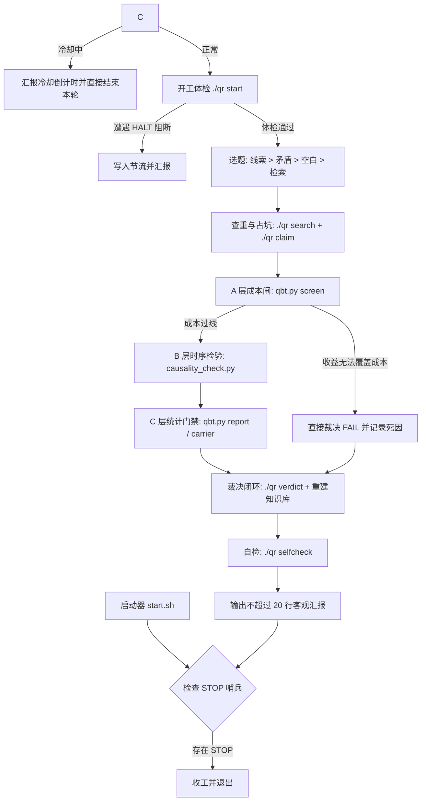

# 量化策略持续探索自动化环境

本环境基于 `continuous-goal` 持续运行模式、`quant_research/qr` 台账系统与 `quant-backtest-protocol` 检验协议，为量化策略研究提供无需人工干预、永不停机、科学严谨的自动化研究循环。

---

## 核心机制



### 1. 无限续跑与平滑终止
- **引擎原理**：依托 omp 运行时的 `--goal` 原生续跑特性，每个回合交互结束后自动提交下一轮目标，杜绝会话单次执行后停滞。
- **哨兵文件**：通过 `touch quant_research/loop/STOP` 或根目录 `touch STOP` 触发平滑终止。当前轮次会完整记录实验数据与日志后再退出，不会破坏文件与台账一致性。
- **防止空转**：遇到网络受阻、数据源限流或上游阻塞时，写入 `quant_research/loop/next-scan.txt` 进行阶段性节流，本轮直接结束并转入下一轮等待，避免高频无意义重试消耗资源。

### 2. 假设生成优先级
严格按照收益期望与研究成本进行四级分层：
1. **未接手线索（`./qr leads`）**：继承前人已验证机理但未完成条件的遗留分支。
2. **矛盾与结构深挖**：针对台账中互相冲突的结论或共同失效模式寻找制度性解释（例如 A 股隔夜/日内异动）。
3. **未探索空白格（`./qr coverage`）**：在资产市场与机理类型的交叉矩阵中填补盲区。
4. **外部检索（`ai-quant-sources`）**：抓取 arXiv、Quantocracy 等公开一手文献，重点检索反面证据。
5. **打分卡校准**：每 5 轮抽取 1 轮中等预期分数的假说，防止评估模型发生偏差。

### 3. 三层证伪漏斗（快速失败）
- **A 层成本初筛**：执行 `qbt.py screen`。如果年化超额毛利无法达到保守交易摩擦成本的 2 倍以上，直接判定为 `STOP` 终止回测，杜绝在不可行策略上浪费 90% 的回测与数据抓取算力。
- **B 层因果与时序**：全部数据与标的池严格符合点在时间（PIT）要求，使用 `causality_check.py` 严格防范前缀依赖与未来函数。
- **C 层候选晋级**：基于 Newey-West HAC 稳健统计量、DSR 多重比较惩罚以及结构匹配置换检验。

### 4. 并发安全性与台账隔离
- **原子占坑与锁**：通过 `locks/<ID>` 和运行标识符 `QR_RUN` 确保多实例同时运行不产生冲突。
- **基线增量自检**：`./qr selfcheck` 仅比对当前轮次的修改增量，工作区已有修改不阻断流程。

---

## 快速使用

### 1. 前台交互式运行（用于调试与观察）
```bash
./quant_research/loop/start.sh
```

### 2. 后台守护运行（在独立 tmux 会话中持续执行）
```bash
RUN_MODE=tmux ./quant_research/loop/start.sh
```
- 查看运行状态：
  ```bash
  tmux attach -t quant-goal-1
  ```
  （离开会话请使用组合键 `Ctrl-b` 后按 `d`）

### 3. 停止运行
```bash
touch quant_research/loop/STOP
```

### 4. 重新启动
```bash
rm quant_research/loop/STOP
./quant_research/loop/start.sh
```
